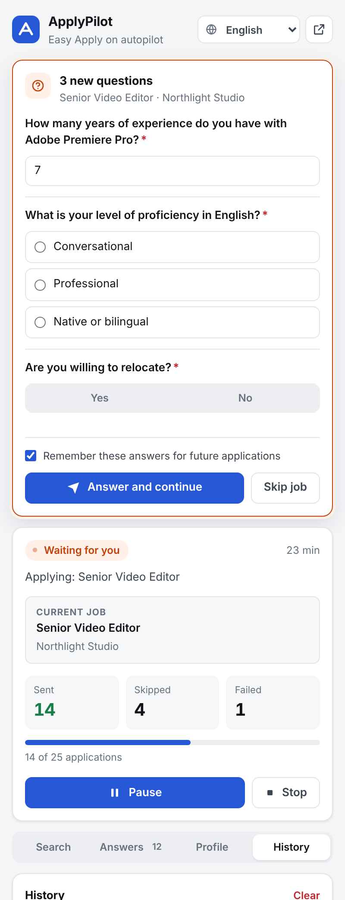

<div align="center">


# ApplyPilot

**An open-source Chrome extension that handles LinkedIn Easy Apply for you, and learns your answers so it asks less every time.**

[Website](https://dudufrg.github.io/linkedin-auto-apply/) · [Install](#installation) · [How it works](#how-it-works) · [Privacy](docs/PRIVACY.md) · [Terms](docs/TERMS.md) · [Architecture](docs/ARCHITECTURE.md)




</div>

---

ApplyPilot searches for jobs with **Easy Apply**, opens each application, fills in what it already knows about you (contact details, the resume you chose, answers you gave before) and **pauses only when it meets a question it has never seen**. You answer once in the side panel; the answer is saved locally and reused on every future application.

- **Learns as you go.** The first run asks a handful of questions. After a few runs it rarely asks anything.
- **Private by design.** Your profile, answers and history never leave your browser. No server, no account, no analytics.
- **Careful, not aggressive.** Human-paced, pauses for captchas and verifications, stops at LinkedIn's daily limit.
- **Three languages.** The interface is available in English, Portuguese and Spanish.

> [!IMPORTANT]
> ApplyPilot is an independent open-source project and is not affiliated with, endorsed by or sponsored by LinkedIn Corporation. Read [Responsible use](#responsible-use) before running it.

## How it works

```
You set job title, location and resume
        │
        ▼
LinkedIn search with the Easy Apply filter (f_AL=true)
        │
        ▼
For each new job ──► open the Easy Apply form
        │                 │
        │                 ├─ Known field?    fill it (profile or answer bank)
        │                 ├─ Unknown field?  pause and ask in the side panel
        │                 │      └─ save the answer for next time
        │                 ├─ Resume step?    select the resume you chose
        │                 └─ Review step?    untick "follow company", submit
        ▼
Random pause ──► next job ──► next results page
```

## Installation

Requirements: Google Chrome 116 or newer (Edge and Brave also work).

1. Clone or download this repository:
   ```bash
   git clone https://github.com/DuduFRG/linkedin-auto-apply.git
   ```
2. Open `chrome://extensions`.
3. Turn on **Developer mode** (top right).
4. Click **Load unpacked** and select the `extension/` folder.
5. Pin the ApplyPilot icon to the toolbar.
6. Open the panel and accept the [terms of use](docs/TERMS.md) (shown once, on first run).

To update after `git pull`, click **Reload** on the extension card. Your data is kept.

## Usage

1. Sign in to LinkedIn as usual.
2. Click the ApplyPilot icon to open the **side panel**. Pick your language with the globe selector (Automatic follows the browser).
3. **Profile** tab: fill in your details. They are only used when LinkedIn does not prefill a field.
4. **Search** tab:
   - **Job title or keyword**, e.g. `Video Editor`, `Photographer`.
   - **Location**, e.g. `Lisbon, Portugal`.
   - **Resume saved on LinkedIn**: a file name, or leave it empty. On the first application ApplyPilot lists the resumes on your account and you pick one.
   - **Goal per run**: how many applications to send before stopping.
5. Click **Start**. A LinkedIn tab opens and is driven by the extension.
6. When a new question appears, the panel shows an orange card and Chrome shows a notification. Answer and click **Answer and continue**, or **Skip job**.

You can **Pause**, **Resume** or **Stop** at any time and keep browsing in other tabs. Only the automation tab is controlled.

### Advanced options

| Option | Default | Description |
| --- | --- | --- |
| Min. / max. pause | 8 s / 12 s | Random wait between submitted applications. |
| Skip jobs containing these words | empty | Skips jobs whose title or company contains any word (e.g. `internship, senior`). |
| Remote jobs only | off | Adds LinkedIn's remote filter to the search. |
| Ask for confirmation before sending | off | Stops at the review step until you click **Send application**. Recommended for your first runs. |
| Also ask about optional fields | on | Unknown optional fields are asked too, so applications go out complete. Turn off to ask only required ones. |
| Follow companies when applying | off | Keeps or unticks LinkedIn's "Follow company" box. |

### Answer bank

The **Answers** tab lists everything ApplyPilot has learned. Search, edit, delete, **Export** a JSON backup or **Import** it on another machine. See the format in [examples/answers.example.json](examples/answers.example.json).

How questions are recognised:

- Labels are normalised (case, accents and punctuation removed), so the same question on different jobs reuses the same answer.
- Choice questions (dropdowns and radio buttons) share answers and are matched against the available options: `Yes` fits `Sim`, `+55` fits `Brazil (+55)`.
- For similar but not identical questions, the panel suggests the closest saved answer. You confirm it.
- If LinkedIn rejects an answer (e.g. "enter a whole number"), the question comes back with the error message and the new answer replaces the old one.

## Edge cases

| Situation | Behaviour |
| --- | --- |
| Already applied | Skipped and recorded in history. |
| No Easy Apply, or job closed | Skipped. |
| New question | Pauses and asks in the panel. |
| Answer rejected by LinkedIn | Asks again with the error (up to 2 times), then discards the application. |
| Field that cannot be filled (e.g. cover letter upload) | Discards the application and records a failure. |
| Unexpected form layout | Multiple fallback selectors; if it still fails, discards and moves on. |
| Captcha, sign-in or checkpoint | Pauses, notifies you and waits until you solve it and click **Resume**. |
| LinkedIn daily limit | Ends the run. |
| Several failures in a row | Pauses so you can check. |
| Tab closed or browser restarted | Run ends safely. |

## Responsible use

Automating a website may conflict with its terms. LinkedIn's [User Agreement](https://www.linkedin.com/legal/user-agreement) (section 8.2) prohibits using bots or other automated methods to access the services, and LinkedIn may restrict accounts that use them. **You are responsible for how you use this software and for any consequences to your account.**

ApplyPilot is built to stay on the conservative side:

- It never solves captchas, spoofs fingerprints, calls private APIs or runs parallel sessions.
- It acts on the page like a person, with random pauses, and stops whenever LinkedIn asks for a verification or reports the daily limit.
- It sends nothing anywhere except the forms you would otherwise submit by hand.

Keep goals modest (for example 20 to 40 per day), review your history, and only apply to jobs that genuinely fit you.

## Privacy

All data lives in `chrome.storage.local` inside your Chrome profile. The extension pages are locked by Content Security Policy to `connect-src 'none'`, so they cannot make network requests at all. Nothing personal is in this repository. Details in [docs/PRIVACY.md](docs/PRIVACY.md).

## Project structure

```
linkedin-auto-apply/
├── extension/                  ← the folder you load in Chrome
│   ├── manifest.json           Manifest V3
│   ├── _locales/               Store name and description (en, pt_BR, es)
│   ├── background/             Start/pause/stop, automation tab, badge, notifications
│   ├── content/                Runs inside LinkedIn
│   │   ├── selectors.js        Every LinkedIn selector and UI string (EN/PT/ES/FR/DE)
│   │   ├── dom.js              Waits, human-like pauses, input setters
│   │   ├── control.js          Pause/stop checkpoints and questions to the user
│   │   ├── fields.js           Reads and fills form fields
│   │   ├── resume.js           Selects the saved resume
│   │   ├── easy-apply.js       State machine for one application
│   │   ├── search.js           Collects job ids from results
│   │   └── runner.js           Orchestrates search → job → next job
│   ├── shared/                 Used everywhere (and by tests)
│   │   ├── i18n.js             PT / EN / ES strings
│   │   ├── storage.js          The only persistence layer
│   │   ├── text.js             Normalisation, question keys, option matching
│   │   ├── profile.js          Maps labels to profile fields
│   │   └── search-url.js       Easy Apply search URLs
│   ├── sidepanel/              UI in plain HTML/CSS/JS, no dependencies
│   └── icons/
├── site/                       Landing page (GitHub Pages)
├── docs/                       Architecture, privacy, screenshots
├── examples/                   Fictional backup file
├── scripts/                    Icon and image generators
└── test/                       Unit tests and Playwright end-to-end tests
```

There is no build step: the files in `extension/` are exactly what Chrome runs.

## Development

```bash
npm install
```

```bash
npx playwright install chromium
```

```bash
npm run test:all
```

- `npm test` runs unit tests (normalisation, option matching, profile mapping, URLs, translations).
- `npm run test:e2e` loads the real extension in Chromium and runs the engine against a mock Easy Apply page (questions, validation errors, resume selection, submission, discard, stop).

When LinkedIn changes its markup, update `extension/content/selectors.js`. See [docs/ARCHITECTURE.md](docs/ARCHITECTURE.md).

## Contributing

Issues and pull requests are welcome, especially new selectors when LinkedIn changes its layout, and translations. Please run `npm run test:all` before opening a PR.

If ApplyPilot saved you time, a star helps other people find it.

## Author

Created and maintained by **Eduardo de Fraga** · Instagram [@dudu_frg](https://www.instagram.com/dudu_frg/) · GitHub [@DuduFRG](https://github.com/DuduFRG).

## Legal

- [Terms of use](docs/TERMS.md) ([Portuguese, canonical](https://dudufrg.github.io/linkedin-auto-apply/termos/))
- [Privacy policy](docs/PRIVACY.md) ([Portuguese, canonical](https://dudufrg.github.io/linkedin-auto-apply/privacidade/))
- [MIT License](LICENSE)

LinkedIn is a trademark of LinkedIn Corporation. This project is independent and not affiliated with, endorsed by or sponsored by LinkedIn.
